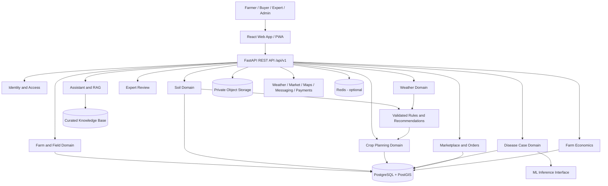

# AgriMitra AI — System Architecture

**Status:** Proposed architecture, version 1.0  
**Initial geography:** West Bengal, India  
**Product:** Responsive web/PWA first; dedicated mobile client after validation  
**Architecture style:** Modular monolith with separately deployable ML inference when justified

## 1. Product vision

AgriMitra AI is an agricultural decision-support and farmer-commerce platform. It connects farm records, soil-test interpretation, crop planning, crop-disease screening, weather intelligence, expert review, market discovery and farmer-to-buyer workflows.

The platform must communicate uncertainty honestly. AI outputs are advisory, not guaranteed diagnoses, yields, prices or profits. Chemical treatment guidance must be based on approved crop- and region-specific references and, where appropriate, expert review.

## 2. Five delivery parts

1. **Part 1 — Architecture and engineering foundation:** product scope, system boundaries, database design, API contracts, ML/data strategy, repository structure and engineering standards.
2. **Part 2 — Frontend:** responsive React application/PWA, navigation, farmer onboarding, farms, soil, crops, disease, weather, calendar, marketplace, finance, expert and assistant experiences.
3. **Part 3 — Backend and database:** FastAPI, PostgreSQL/PostGIS, authentication, domain services, migrations, file storage, authorization and API integration.
4. **Part 4 — AI and ML:** disease screening, soil interpretation, crop suitability, yield estimation, price forecasting and grounded agricultural assistant.
5. **Part 5 — Integration and launch:** end-to-end testing, security, observability, deployment, field pilot, support and product iteration.

Each part ends with a demonstrable milestone, tests and documentation. The order is a delivery sequence, not a restriction on designing interfaces early.

## 3. Target users and roles

- Farmer: owns farms, fields, crop cycles, soil records, listings and farm financial records.
- Buyer: discovers produce, submits offers and manages purchases.
- Agricultural expert: reviews escalated cases and publishes verified guidance.
- Supplier: publishes eligible agricultural input listings in a later marketplace phase.
- Platform administrator: manages verification, moderation, taxonomy and operational support.

Use role-based permissions plus resource ownership checks. A farmer must not access another farmer's private farm, image, soil report or financial record merely by guessing an identifier.

## 4. High-level architecture

### Architectural decisions

- Start with a **modular monolith** in FastAPI. Keep domains separated by routers, services, repositories, schemas and models. Do not introduce microservices before scale or team boundaries justify them.
- Use PostgreSQL as the system of record. Add PostGIS for farm coordinates and spatial queries.
- Store uploaded images and documents in private object storage; keep metadata and access permissions in PostgreSQL.
- Treat ML models as versioned inference components behind stable interfaces. A separate inference service can be extracted later if performance, scaling or dependency isolation requires it.
- Use Redis and a background worker only when there are real asynchronous workloads such as image inference, notifications, report generation or scheduled data ingestion.
- Build a responsive PWA first. A future React Native client can consume the same versioned API.
- Keep third-party integrations behind adapter interfaces so vendors can be changed without rewriting domain logic.

## 5. Technology stack

| Layer | Initial choice | Notes |
|---|---|---|
| Web/PWA | React + Vite | Existing frontend foundation |
| UI | Bootstrap 5 + custom CSS | Responsive component system |
| Routing | React Router | Client-side navigation |
| Charts | Recharts | Farm and business analytics |
| API | Python + FastAPI | Versioned REST API |
| Validation | Pydantic | Request/response contracts |
| ORM | SQLAlchemy | Database access |
| Database | PostgreSQL | Primary relational store |
| Geospatial | PostGIS | Coordinates and spatial search |
| Migrations | Alembic | Reproducible schema changes |
| Authentication | Phone OTP and/or password + JWT session | Provider and threat model to be selected before production |
| ML | PyTorch, scikit-learn; evaluate TensorFlow only if needed | Choose per model, avoid duplicate frameworks without reason |
| Image processing | Pillow / OpenCV | Upload validation and preprocessing |
| Assistant | LLM + retrieval augmented generation | Ground answers in approved sources |
| Cache/worker | Redis + worker framework, later | Add only for required jobs |
| Storage | S3-compatible private object storage | Images, soil reports and documents |
| Packaging | Docker | Consistent local and production environments |
| CI | GitHub Actions | Lint, tests, build, security checks |
| Observability | Structured logs and error tracking; metrics later | Do not log sensitive personal data |

## 6. Functional modules

1. Farmer dashboard: farm summary, tasks, alerts, recent activity and relevant insights.
2. Farm management: farm profile, location, area, fields, irrigation and ownership.
3. Soil intelligence: sample capture, lab report attachment, measured parameters, interpretation and recommendations.
4. Disease screening: image submission, crop/context metadata, model prediction, uncertainty handling and expert escalation.
5. Crop recommendation: location/season/soil/water suitability, ranked alternatives and explainable factors.
6. Weather intelligence: forecast and observed data with provider, timestamp and location provenance.
7. Farming calendar: crop-cycle tasks, reminders and event history.
8. Marketplace: seller profiles, produce listings, buyer discovery, offers, orders and delivery coordination.
9. Market intelligence: sourced mandi prices, historical trends and carefully labelled forecasts.
10. Farm economics: expenses, harvests, sales, gross margin and estimated net return.
11. Expert network: case queue, consultations, expert review and feedback.
12. AgriMitra assistant: Bengali/English initially, Hindi later; text first, voice and image workflows after reliable core service.

## 7. Domain data flow

### Crop recommendation
Farmer selects a field and crop-planning period. The service loads farm/field data, available soil-test measurements, water access, crop history and weather/season context. A transparent rules baseline filters unsuitable candidates. A ranking model may order remaining crops when validated data exists. The response includes suitability factors, missing inputs, assumptions, source timestamps and uncertainty. Economics estimates are shown separately and never described as guaranteed profit.

### Disease screening
Farmer uploads a crop image and supplies crop, location, plant stage and symptoms if known. The API validates file type and size, stores it privately, creates a case and invokes the versioned model. The response includes possible class, confidence, limitations and next step. Low confidence, out-of-distribution or severe cases are routed to an expert. Treatment guidance is only served from approved crop-specific references and is not generated solely from a classifier label.

### Soil intelligence
The farmer enters test values or attaches a lab report. Measured values retain units, lab/source, sample date and method where available. The system validates ranges and flags missing or implausible values. Rules and expert-reviewed references interpret results. A photo is not treated as a measurement of NPK or pH.

### Marketplace
A verified seller creates a listing with crop/produce, quantity, unit, grade, harvest/availability date, location and asking price. Buyers discover listings and submit offers. Seller accepts/rejects/counters. An order is created from an accepted offer. Payment and delivery status are updated only from authorized, verified events.

## 8. Data and integration strategy

Potential sources to evaluate, subject to access, licensing, freshness and geographic coverage:
- Crop disease benchmarks: PlantVillage and PlantDoc; supplement with consented, expert-labelled field images from West Bengal.
- Agronomy and soil interpretation: ICAR, Bidhan Chandra Krishi Viswavidyalaya, KVK and state agriculture extension publications; soil laboratory results are the measurement ground truth.
- Weather: IMD and a suitable weather API provider. Persist provider and observation/forecast timestamps.
- Market: Agmarknet and eNAM or authorized provider feeds. Preserve market, commodity, variety, unit, date and source.
- Geospatial: OpenStreetMap and suitable official geographic datasets, respecting terms and attribution.
- Schemes: official central and West Bengal government portals only.

Never assume an API is public or that a dataset can be redistributed. Create a dataset card recording source, license, geography, time span, labels, consent, preprocessing and known limitations before training.

## 9. Security, privacy and safety

- HTTPS in all deployed environments; secrets only in environment/secret manager, never Git.
- Passwords (if supported) hashed with a modern password hashing scheme; OTP flows rate-limited and protected from enumeration.
- JWT/session expiry, refresh rotation and revocation strategy defined before production.
- Role-based access plus per-resource ownership checks on every private object.
- Validate and limit uploads; scan files; use private buckets and short-lived signed URLs.
- Minimize personal data collection; obtain consent for location, images, analytics and any secondary model-training use.
- Provide a retention/deletion process and audit privileged access.
- Use parameterized database operations, request validation, rate limiting, CORS allowlists and security headers.
- Verify payment webhooks server-side and make order/payment operations idempotent.
- Log request IDs and operational events, but redact credentials, OTPs, personal data and private image URLs.
- AI recommendations show source, timestamp, model/rule version, uncertainty and escalation path.
- Never present a prediction as a confirmed diagnosis or guaranteed yield/price/profit. Chemical advice must match approved labels, crop, target pest/disease and local regulations, with expert review where needed.

## 10. Reliability and operations

- Health and readiness endpoints for API and workers.
- Database backups with documented restore tests.
- Idempotency for payment and order callbacks.
- Retry with bounded backoff for external providers; circuit-break or degrade gracefully.
- Cache only data with explicit freshness/expiry policy.
- Monitor API latency/error rates, worker queue depth, model latency, external provider failures and storage errors.
- Keep development, staging and production configuration separate.
- CI should run frontend build, backend tests, lint/type checks and dependency/security checks.

## 11. Non-functional requirements

- Mobile-first responsive UI and accessible forms.
- Support low-bandwidth conditions: compressed images, small payloads, clear loading/error/retry states.
- Bengali and English content architecture from the beginning; Hindi can follow.
- Every time-sensitive data item carries a timestamp and source.
- Pagination and filtering for marketplace and farm records.
- Model evaluation must include regionally relevant holdout data and per-class/per-region metrics.
- Graceful fallback when weather, market or AI providers are unavailable.

## 12. Release strategy

### Pilot release
Farmer onboarding, farm/field records, manual soil-test entry, basic crop planning, image case submission with expert review, sourced weather view and simple produce listings/contact.

### Intelligence release
Validated disease screening, soil interpretation, crop ranking, calendar recommendations, market history and farm economics.

### Marketplace expansion
Offers, order management, verified buyers/sellers, payment integration, logistics and dispute handling after legal and operational review.

### Scale release
Dedicated mobile client, regional model calibration, more languages, more states, richer analytics and selectively extracted services.

## 13. Definition of done

A feature is not complete because its page renders. It is complete when:
- UX handles loading, empty, success, validation and failure states.
- API schema and authorization are implemented.
- Database migration and rollback considerations exist.
- Unit/integration tests cover business rules and access boundaries.
- Sensitive data and files are protected.
- Observability and user-facing error messages exist.
- Documentation and acceptance criteria are updated.
